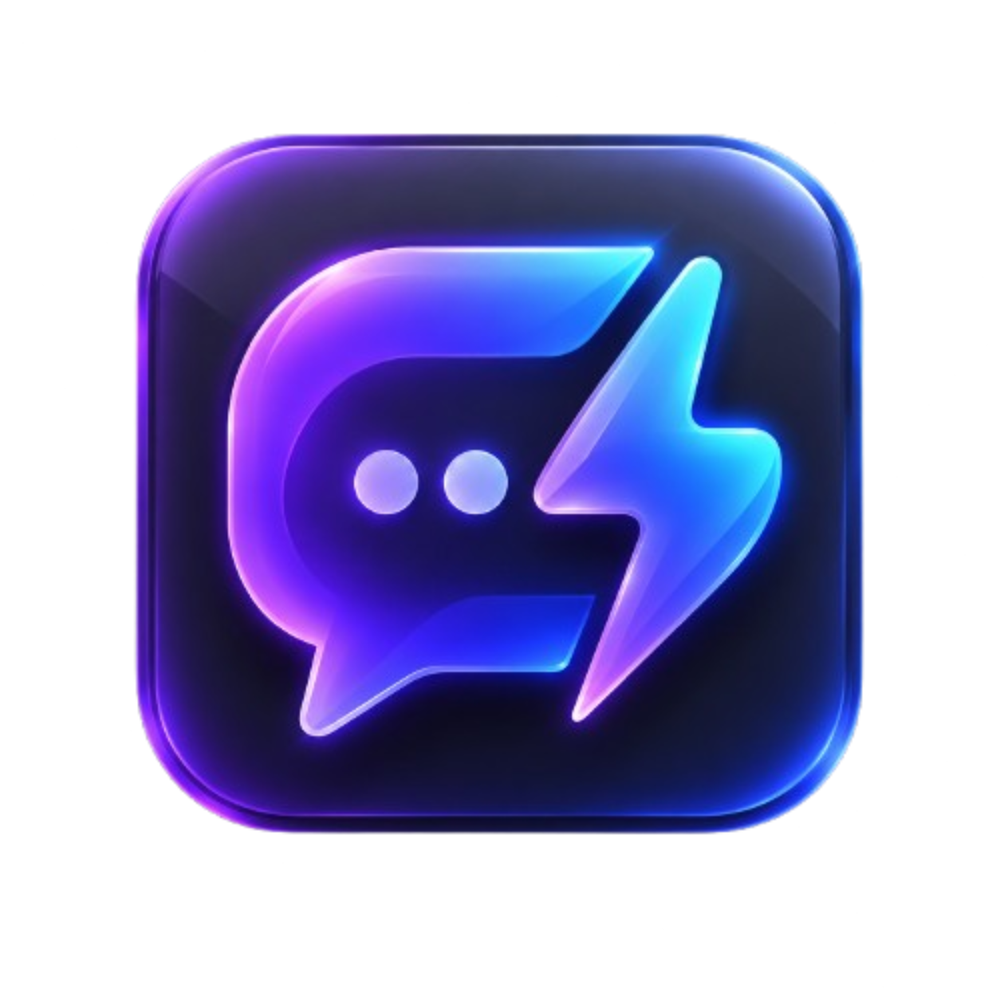
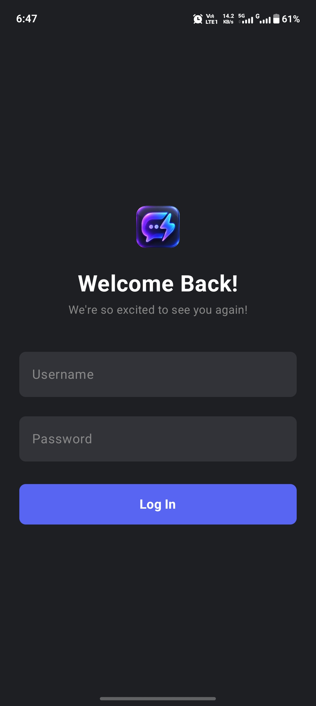
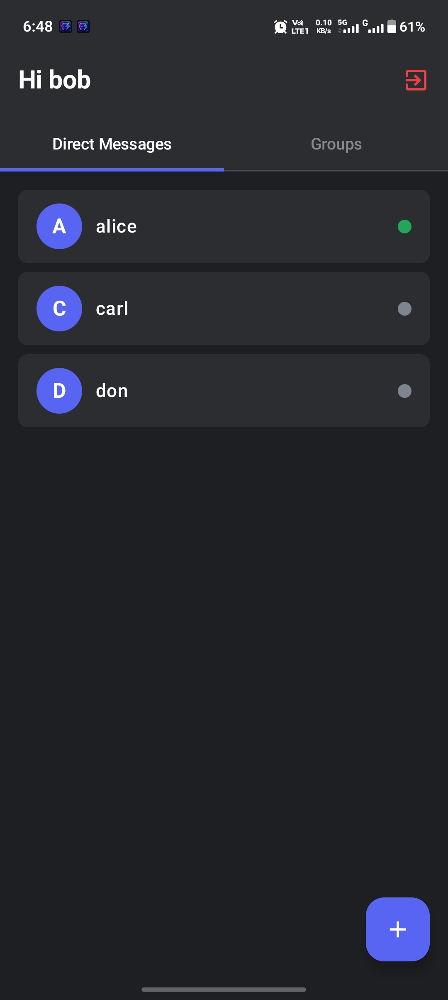
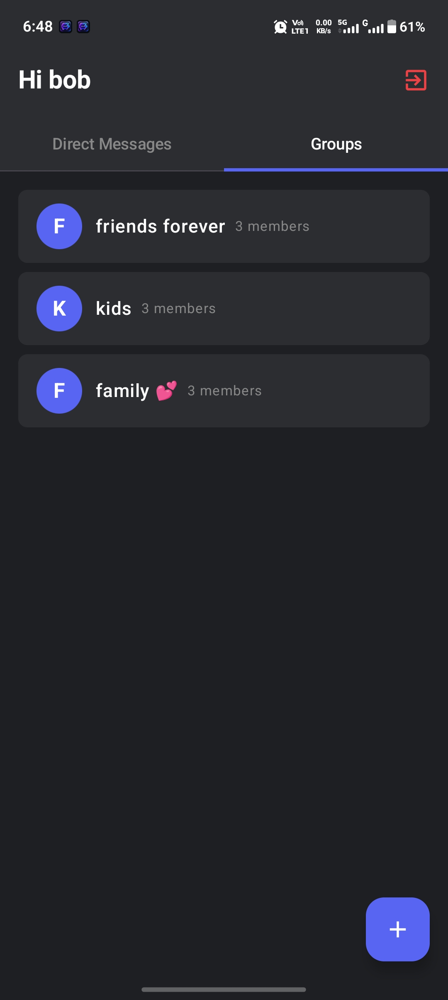
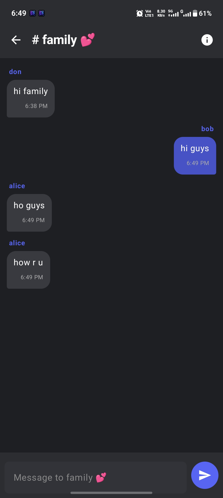
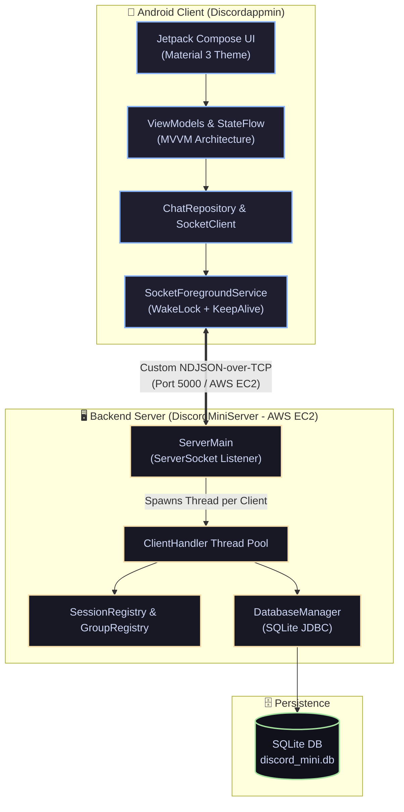

<div align="center">

<br/>



# ⚡ DiscordMini

### *Real-Time Distributed Messaging Ecosystem — Built from Scratch*

<br/>

[](https://github.com/GPramodh07/Discord-Mini-App/releases/download/v2.0.0/DiscordMiniApp_V2.0.0.apk)
[](https://drive.google.com/file/d/14AuAz-yuUiJYktQX4oqyUHer7FbeqRio/view?usp=sharing)

<br/>

[](https://developer.android.com/jetpack/compose)
[](https://kotlinlang.org/)
[](https://openjdk.org/)
[](https://www.sqlite.org/)
[](https://aws.amazon.com/)
[](https://en.wikipedia.org/wiki/Transmission_Control_Protocol)
[](LICENSE)

<br/>

> **DiscordMini** is a full-stack real-time messaging ecosystem featuring a modern **Jetpack Compose Android Client** powered by an **Android Foreground Service** connected to a multithreaded **Java TCP Socket Backend** deployed live on **AWS EC2**.

<br/>

<div align="center">

<a href="https://github.com/GPramodh07/Discord-Mini-App/releases/download/v2.0.0/DiscordMiniApp_V2.0.0.apk">
  
</a>
&nbsp;&nbsp;
<a href="https://drive.google.com/file/d/14AuAz-yuUiJYktQX4oqyUHer7FbeqRio/view?usp=sharing">
  
</a>

</div>

</div>

---

## 📸 App Showcase

<div align="center">

| 🔐 **Authentication** | 💬 **Direct Messages** | 👥 **Group Channels** | 💬 **Group Chat** |
|:---:|:---:|:---:|:---:|
|  |  |  |  |

</div>

---

## ✨ Production Feature Highlights

- 🚀 **Production-Ready Android Release**: Pre-built Android APK ready for immediate deployment ([**Download v2.0.0 APK**](https://github.com/GPramodh07/Discord-Mini-App/releases/download/v2.0.0/DiscordMiniApp_V2.0.0.apk)).
- ☁️ **AWS Cloud VPS Backend**: Multithreaded TCP server deployed on AWS EC2 (`3.107.163.173:5000`) with automatic local fallback for USB ADB debugging (`127.0.0.1`).
- ⚠️ **Comprehensive Error Handling & Authentication**:
  - **Server Down Alert**: Displays `"Server is not running, contact admin"` when TCP connections fail.
  - **Invalid Password**: Surfaced as `"Incorrect password. Please try again."`.
  - **Account Verification**: Surfaced as `"User does not exist in database"`.
- 🔴 **WhatsApp & Discord Style Unread Badges**: Real-time unread count badges (`1`, `2`, `99+`) rendered on the right corner of DM contacts and group items, automatically clearing upon entering the conversation.
- 🔋 **Android Foreground Service & CPU WakeLocks**: `SocketForegroundService` uses a CPU `PARTIAL_WAKE_LOCK` to keep TCP socket connections alive when the app is minimized, screen-locked, or running in dual app clones.
- 💬 **Strict 1:1 DMs & Group Channels**: Complete separation between private direct messages and multi-user group chat channels.
- 🚪 **Explicit Disconnection & Logout**: Action bar logout with confirmation dialog sending `PRESENCE OFFLINE` packets, closing socket streams, stopping foreground services, and clearing navigation state.
- 🗑️ **Cross-Client Real-Time Message Deletion**: Synchronized message deletion across all connected clients backed by SQLite database persistence.
- 🟢 **Live Online Presence Indicators**: Real-time broadcast of online/offline status for contacts.
- 🗄️ **SQLite Sync & Persistence**: Automatic history restoration, group channel loading, and offline message queueing powered by SQLite JDBC.

---

## 🏗️ System Architecture & Protocol

### Architecture Diagram



### Custom NDJSON Packet Protocol

The Android client and Java backend communicate over raw TCP using line-delimited JSON objects:

```json
{"type":"LOGIN","sender":"alice","password":"123"}
{"type":"PRIVATE_MSG","sender":"alice","recipient":"bob","content":"Hello Bob!","id":"msg-123"}
{"type":"GROUP_MSG","sender":"alice","groupId":"g1","content":"Hey everyone!","id":"msg-456"}
{"type":"DELETE_MSG","sender":"alice","content":"msg-123"}
{"type":"ERROR","sender":"SERVER","recipient":"alice","content":"Incorrect password. Please try again."}
```

---

## 📲 Download & Test Credentials

### 1️⃣ Download APK

<div align="center">

<a href="https://github.com/GPramodh07/Discord-Mini-App/releases/download/v2.0.0/DiscordMiniApp_V2.0.0.apk">
  
</a>
&nbsp;&nbsp;
<a href="https://drive.google.com/file/d/14AuAz-yuUiJYktQX4oqyUHer7FbeqRio/view?usp=sharing">
  
</a>

</div>

### 2️⃣ Pre-Seeded Test Credentials

| 👤 Username | 🔑 Password | 📌 Roles / Notes |
|:-----------:|:-----------:|:-----------------|
| `alice` | `123` | Active User (DM & Groups) |
| `bob` | `456` | Active User (DM & Groups) |
| `carl` | `789` | Active User (DM & Groups) |
| `don` | `101` | Active User (DM & Groups) |

> 💡 **Testing Tip**: Log into two accounts simultaneously (using two physical phones or Android App Clones) to experience real-time 2-way messaging, unread counter pills, online status changes, and background socket connectivity.

---

## 🛠️ Repository Structure

```
DiscordMini/
├── assets/                     # 🎨 App Logo & Showcase Screenshots
├── Discordappmin/              # 📱 Android Client (Kotlin + Jetpack Compose)
│   ├── app/
│   │   ├── src/main/java/com/example/discordappmin/
│   │   │   ├── network/        # SocketClient & SocketPacket Protocol
│   │   │   ├── repository/     # ChatRepository (IP Config, StateFlow & Login)
│   │   │   ├── service/        # SocketForegroundService (Background Keep-Alive & WakeLock)
│   │   │   └── ui/             # Jetpack Compose Screens & ViewModels
│   └── build.gradle.kts
│
└── DiscordMiniServer/          # 🖥️ Java TCP Backend Server (Java 17 + SQLite JDBC)
    ├── src/main/java/com/discordmini/server/
    │   ├── db/                 # DatabaseManager (SQLite JDBC CRUD)
    │   ├── handler/            # ClientHandler (NDJSON Protocol Parser & Auth)
    │   └── registry/           # SessionRegistry & GroupRegistry
    └── lib/                    # json.jar, sqlite.jar
```

---

## 💻 Building & Running from Source

### 1️⃣ Java Server Backend

```bash
cd DiscordMiniServer

# Compile Java server source
javac -d bin -cp "lib/*" $(find src -name "*.java")

# Launch server on TCP port 5000
java -cp "bin:lib/*" com.discordmini.server.ServerMain
```

### 2️⃣ Android Client

Open `Discordappmin` in Android Studio and build the project, or build directly via Gradle wrapper:

```bash
cd Discordappmin

# Build debug APK
./gradlew assembleDebug
```

### 3️⃣ Local USB ADB Reverse (Optional)

If running the backend locally instead of AWS EC2:

```bash
# Reverse TCP port 5000 from mobile device to PC
~/Android/Sdk/platform-tools/adb reverse tcp:5000 tcp:5000
```

---

## 📄 License

Distributed under the **MIT License**. See `LICENSE` for more information.

<div align="center">

Crafted with 💜 **Kotlin** & ☕ **Java** &nbsp;•&nbsp; **DiscordMini Monorepo**

</div>
